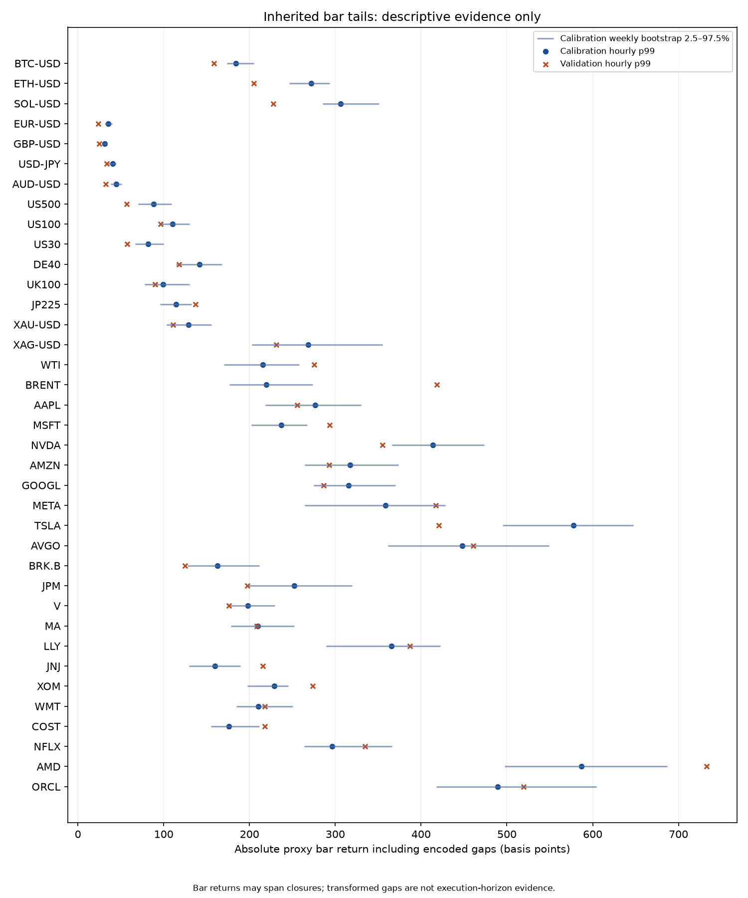
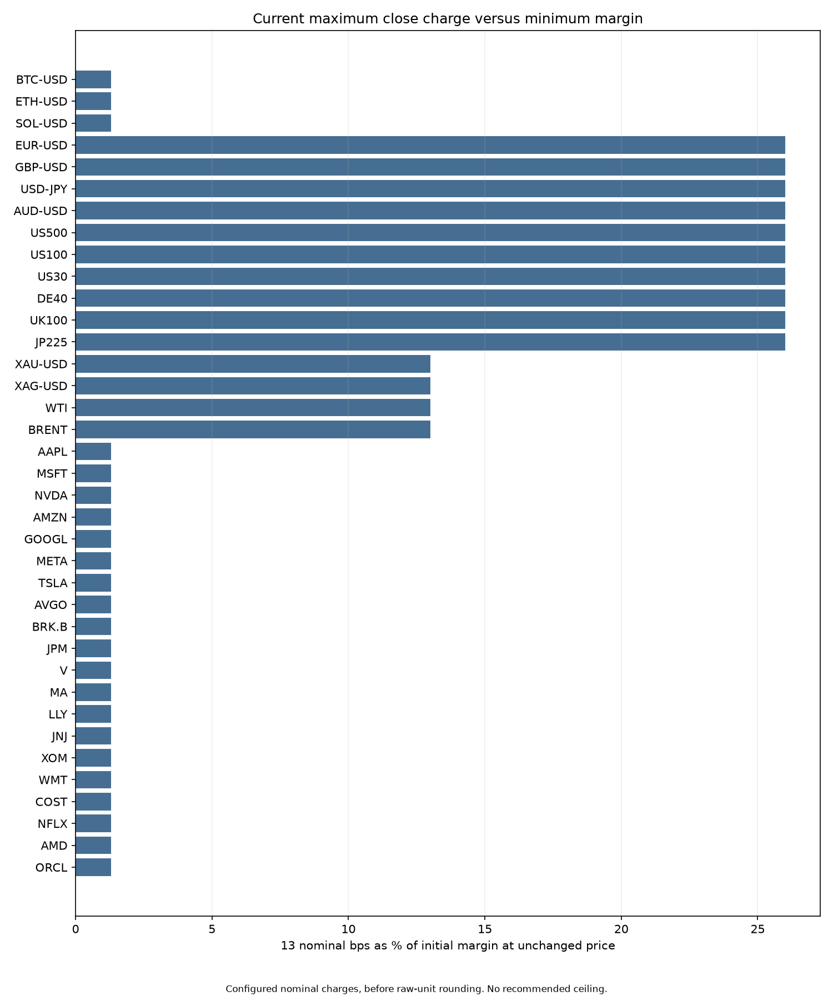

# Preliminary close-spread calibration

**All 37 production recommendations remain blocked pending evidence. No ceiling is adopted.**

The pipeline pins genesis and inherited source hashes. Hourly observations are transformed
proxies, with selected gaps removed. They do not measure actual execution-horizon reference
divergence, staleness, contract rolls or all corporate actions. Source and licensing gaps
are listed in [the source audit](../source-audit.md).

Calibration: 2024-10-28T00:00:00+00:00 to 2026-04-27T00:00:00+00:00 exclusive.
Validation: 2026-04-27T00:00:00+00:00 to 2026-10-12T00:00:00+00:00 exclusive.

A fixed ceiling limits operator power. The charged spread is a separate engine calculation.
Current global parameters charge at most 13 nominal bps for a voluntary pure close and
10 for liquidation, before raw-unit rounding. A pure close pays no size spread. Market
volatility and gaps affect solvency and margin; they are not themselves spread charges.

The same nominal cost consumes different shares of initial margin: 13 bps is 26% of a
50-bps margin and 1.3% of a 1,000-bps margin at an unchanged price. Neither amount is a
recommended ceiling. The conditional gap sweep separates trader cost from house shortfall,
with zero/seeded capital and explicit hypothetical operator-charge changes. Scenario counts
are not probabilities. Weekly bootstrap intervals capture only sampling sensitivity.

| Market | Calibration hourly p99 (bps) | Validation hourly p99 (bps) | Proposed ceiling |
|---|---:|---:|---|
| BTC-USD | 184.37 | 158.79 | Blocked: missing evidence |
| ETH-USD | 271.72 | 204.81 | Blocked: missing evidence |
| SOL-USD | 306.08 | 227.89 | Blocked: missing evidence |
| EUR-USD | 35.45 | 23.73 | Blocked: missing evidence |
| GBP-USD | 31.44 | 24.76 | Blocked: missing evidence |
| USD-JPY | 40.78 | 33.63 | Blocked: missing evidence |
| AUD-USD | 44.83 | 32.31 | Blocked: missing evidence |
| US500 | 88.11 | 56.82 | Blocked: missing evidence |
| US100 | 110.34 | 96.09 | Blocked: missing evidence |
| US30 | 81.98 | 57.62 | Blocked: missing evidence |
| DE40 | 141.55 | 118.04 | Blocked: missing evidence |
| UK100 | 99.18 | 90.12 | Blocked: missing evidence |
| JP225 | 114.53 | 136.96 | Blocked: missing evidence |
| XAU-USD | 128.92 | 110.91 | Blocked: missing evidence |
| XAG-USD | 268.58 | 230.98 | Blocked: missing evidence |
| WTI | 215.29 | 275.13 | Blocked: missing evidence |
| BRENT | 219.52 | 418.15 | Blocked: missing evidence |
| AAPL | 276.25 | 255.80 | Blocked: missing evidence |
| MSFT | 237.17 | 293.23 | Blocked: missing evidence |
| NVDA | 413.88 | 354.95 | Blocked: missing evidence |
| AMZN | 317.31 | 292.93 | Blocked: missing evidence |
| GOOGL | 315.43 | 286.19 | Blocked: missing evidence |
| META | 358.23 | 417.16 | Blocked: missing evidence |
| TSLA | 577.33 | 420.60 | Blocked: missing evidence |
| AVGO | 447.73 | 460.83 | Blocked: missing evidence |
| BRK.B | 162.40 | 124.96 | Blocked: missing evidence |
| JPM | 252.28 | 197.22 | Blocked: missing evidence |
| V | 198.08 | 176.02 | Blocked: missing evidence |
| MA | 209.78 | 208.72 | Blocked: missing evidence |
| LLY | 365.34 | 387.09 | Blocked: missing evidence |
| JNJ | 159.46 | 215.41 | Blocked: missing evidence |
| XOM | 228.76 | 273.43 | Blocked: missing evidence |
| WMT | 210.47 | 217.78 | Blocked: missing evidence |
| COST | 175.87 | 218.00 | Blocked: missing evidence |
| NFLX | 296.18 | 334.64 | Blocked: missing evidence |
| AMD | 587.03 | 732.54 | Blocked: missing evidence |
| ORCL | 489.30 | 519.22 | Blocked: missing evidence |

## Adoption gates

Obtain instrument-specific raw/reference evidence, resolve its permitted use and
audit session gaps, corporate actions and rolls. Select a trader-burden/house-loss
objective after reviewing the frontier, then adopt per-market values explicitly.
Missing evidence must remain missing; no uniform fallback is justified by this report.

This initial risk model conditions on two existing isolated positions and one unseen
price jump. It does not establish correlated portfolio or full cross-margin risk,
admission capacity, continuous-path liquidation timing, or modelled probabilities.
Its account-cost arithmetic is not a substitute for complete Engine::apply agreement.
The separate shared V17 pricing vectors exercise actual close/reversal/liquidation
and FX rounding. No protocol fixture or production config has been changed.
